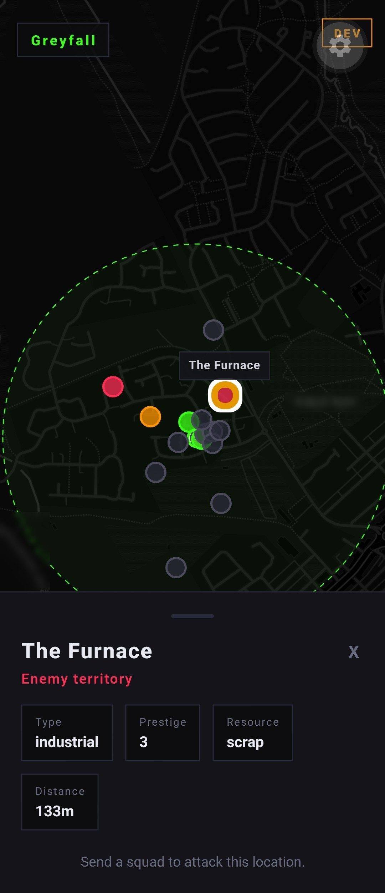
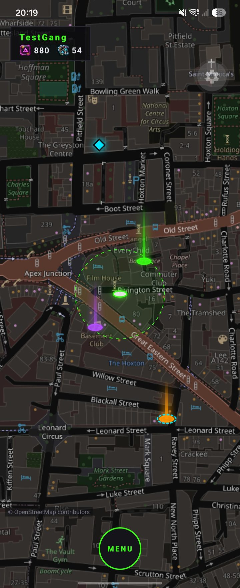
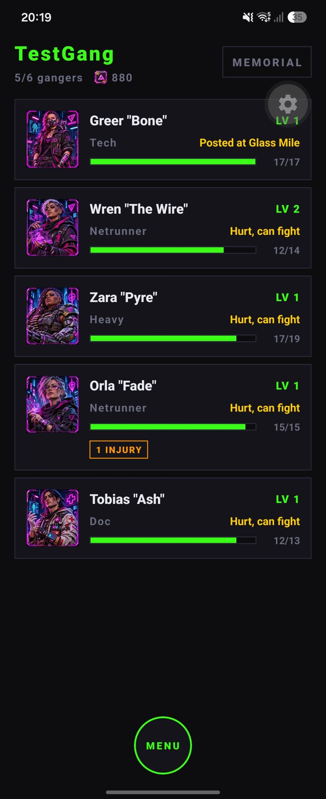
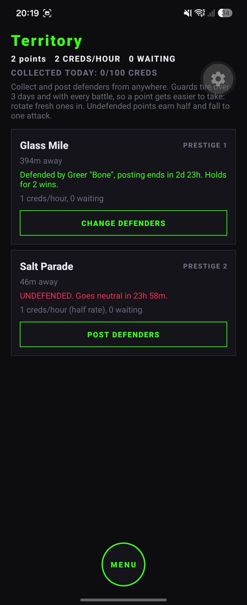

*Personal project, Android prototype. FastAPI and PostGIS; React Native
(Expo) for the mobile client.*

A grimdark, location-based gang-territory game — an inspiration pot of
Pokémon GO, Necromunda/Warhammer 40k, and Cyberpunk 2077. Built mainly to
see how something like Pokémon GO actually works under the surface:
geofenced locations, proximity checks, spatial queries at scale.

## What's there

It started as a map with territory and gangs. It's now a full game loop:
you walk to real places to recruit fighters, take and hold territory, and
send squads into fights where you choose how hard they push — knowing the
hardest push can get them killed.

Gangers are people rather than units. Each has a name, a history, lasting
injuries, and cyberware that makes them stronger and less stable; the dead
go to a Memorial with their record. Around that sit rival gangs that move
on your turf while you're away, sieges, remote hacking runs where you race
the trace across a grid, seasonal events, pets and a weekly shop.

  <figure>
    
    <figcaption>September 2026: the first build</figcaption>
  </figure>
  <figure>
    
    <figcaption>November 2026: real places from OpenStreetMap</figcaption>
  </figure>
  <figure>
    
    <figcaption>The gang</figcaption>
  </figure>
  <figure>
    
    <figcaption>Territory</figcaption>
  </figure>

<video class="clip portrait" controls muted playsinline preload="metadata"
       poster="/assets/grid/gameplay-poster.jpg">
  <source src="/assets/grid/gameplay.mp4" type="video/mp4">
</video>

*Under a minute of play, with the phone's location set to Shoreditch,
London: the gang, a rival point, a hacking run, then a defeat and a
victory.*

## Real places, chosen carefully

Points on the map come from OpenStreetMap, through the Overpass API. The
first time anyone comes within 1.5 km of an area, its places are fetched
once and stored, so every player sees the same map.

Most of the work went into where a point is *not* allowed to go:

- **Only public places**, never homes or anything private
- **Nothing within 100m** of schools, nurseries, hospitals, care homes,
  police and fire stations; 60m of playgrounds; 50m of places of worship,
  cemeteries and memorials
- **Parks are favoured** — open, public and safe for people to meet up
- **Real data sets a point's place and type, never its name**, so no real
  business ends up branded as gang turf

The data rules get the same care. OpenStreetMap is ODbL, so the map credits
it, and every point records its source so the derived list could be
handed over under share-alike if needed. Neither the public Overpass
servers nor OpenStreetMap's own tiles are meant to back an app with real
users, so both are marked to be replaced before launch.

## Status

A working Android prototype. Many of the newest systems are built but
still waiting for proper testing on a phone. The art is mostly
AI-generated placeholder.

Before anyone else could play it, it would need sign-in, proper handling
of location data under UK GDPR, a way to report a bad point, its own map
and place services, and licence advice. Whether it gets that far is an
open question — it's already done its job as a way to learn how these
games are built.

Really fun though :)
