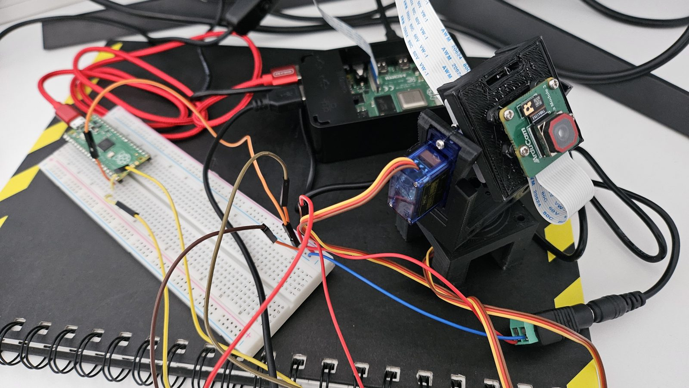
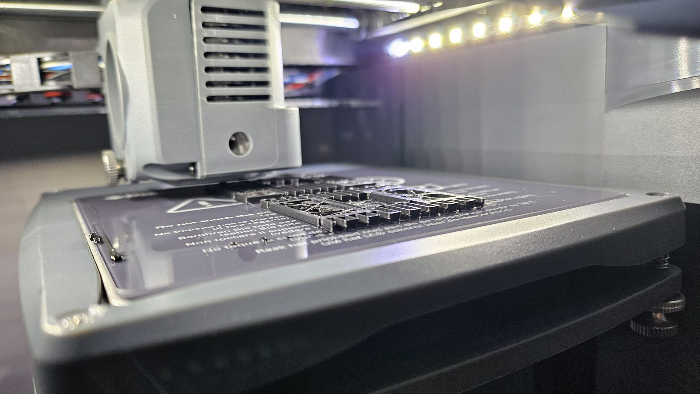
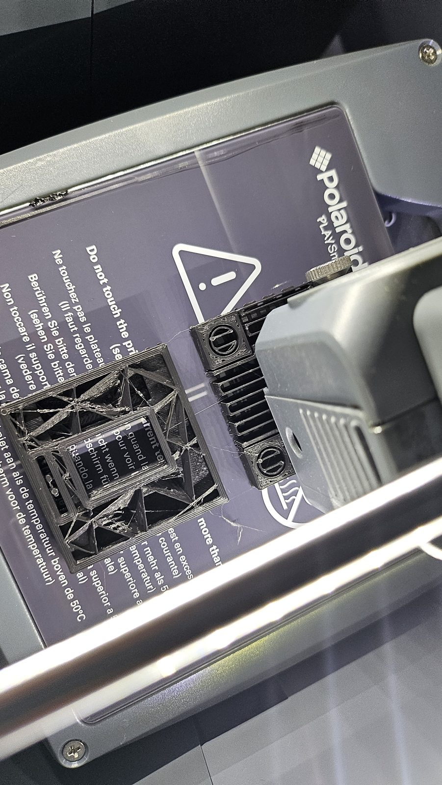
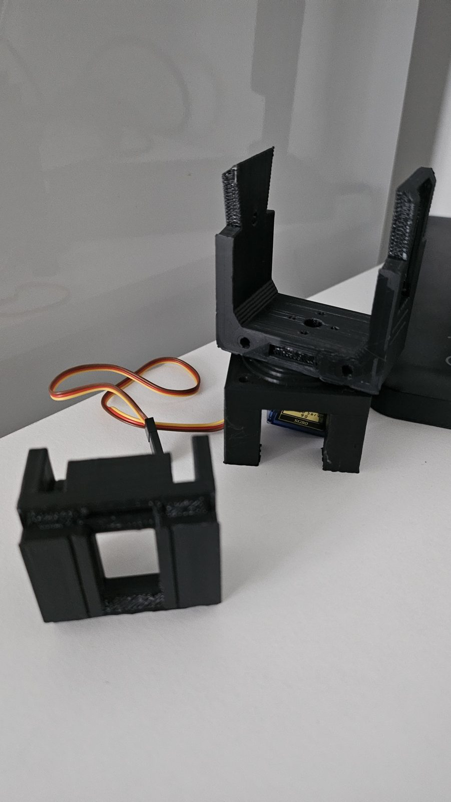

*Personal project, early days. Raspberry Pi 4B and Pico, Arducam Camera
Module 3, two SG90 servos, and a 3D-printed head.*



The aim is a small, self-contained learning robot — something that runs on
a Raspberry Pi 4B rather than in a data centre. An external AI might help
it name things later, but nothing it learns will depend on one: a model
that can't change can't get better at predicting, so there'd be nothing
for it to learn from.

Right now it's a camera head that turns to follow movement. There's no
learning in it yet — it's a control loop with motion detection. But knowing
where it is, and what its own movement does to what it sees, is what
anything that learns will have to stand on. And it's been a lot of fun.

## The build

The head is three custom parts — a base plinth, a yoke and a tilt camera
mount — designed in CAD with Claude, sliced in Ultimaker Cura and 3D
printed.

<div class="photo-row">
  
  
  
</div>

Not everything fitted first time. The tilt member wouldn't turn, and the
reason was a detail none of the automated checks could catch: an SG90's
output shaft isn't in the middle of the servo. It sits 5.5 mm off centre.
The yoke had been designed around a symmetric box with the shaft at the
middle, so the drive axis and the pivot axis ended up 5.5 mm apart — which
isn't a pivot, it's a crank, and it jams. Every clash test passed, because
every clash test had the servo modelled the same wrong way. It took looking
at the thing and watching how it moved.

The Pi handles the camera and the vision. A Raspberry Pi Pico drives the
two servos, talking to the Pi over USB, and the servos have their own power
supply.

The parts are free to print:
[base plinth](/assets/robot-head/base-plinth.stl) ·
[yoke](/assets/robot-head/yoke.stl) ·
[tilt camera mount](/assets/robot-head/tilt-camera-mount.stl) (STL)

## Following movement

It doesn't recognise anything yet; it follows motion of any kind. It works
out how much its own movement shifted the image, lines the two frames up
and subtracts. Whatever is left — a hand, say — is what it turns towards.

### First version: look, move, stop

<video class="clip" controls muted playsinline preload="metadata"
       poster="/assets/robot-head/tracking-first-poster.jpg">
  <source src="/assets/robot-head/tracking-first.mp4" type="video/mp4">
</video>

The first version moved in jerks, and the cause wasn't the servos. The head
couldn't tell its own movement from the world's. When the camera turns,
every pixel shifts, so a moving camera sees motion everywhere. The only way
it could find real motion was to stop, hold still and look — so it moved in
saccades: look, move, stop, settle, look.

### Second version: continuous

<video class="clip" controls muted playsinline preload="metadata"
       poster="/assets/robot-head/tracking-continuous-poster.jpg">
  <source src="/assets/robot-head/tracking-continuous.mp4" type="video/mp4">
</video>

Working it through with Claude, three changes fixed different parts of the
problem:

- **Non-blocking firmware.** The Pico used to set the servo position, wait
  out the move, then reply, leaving the Pi idle through every move. Now it
  runs a 100 Hz ramp loop and accepts a new target straight away.
- **Cancelling its own movement.** The head can work out the image shift
  its own movement caused, line the frames up and subtract. What's left is
  motion that isn't its own. That removed a 0.2-second settle pause that
  had been about two-thirds of every cycle. Biology got there first: von
  Holst and Mittelstaedt described this as the reafference principle in
  1950. It's why the room doesn't lurch every time you glance sideways.
- **Correcting from where it is, not where it was told to go.** Each
  correction was being added to the commanded position, which could run up
  to 15° ahead of where the servo actually was. That guaranteed overshoot.
  In the logs, the error held roughly steady, flipped sign at the
  turnaround and held steady again — orbiting rather than converging.
  These are degrees of pointing error, one per cycle:

```
Before:  -7.9  -5.9  -5.0  -4.6  -7.3  -4.3  -6.1  -9.9 … +12.3  +9.9  +8.9
After:  -17.3 -14.9 -13.5  -7.0  -2.1  +4.4  +2.3
```

One refinement mattered more than expected. Servos lag behind their
commands, and most of all when moving fastest, so cancelling with the
*predicted* shift failed exactly when it was needed. The whole frame looked
like motion and the head chased itself. Measuring the actual shift between
frames instead, by phase correlation, and keeping the prediction only as a
learning signal, fixed it.

The loop went from under 4 to about 10 updates a second, but the real
change is that it no longer has to stop. I wouldn't call it smooth yet.
There's still about 100 ms between seeing and acting, the control is
proportional-only, and the tilt has a mechanical deadband I haven't tracked
down. Saccadic to continuous is the honest claim.

## Status

Early days, and the code isn't public yet.

The next step is the one that turns it from a tracking robot into a
learning one. Everything it currently knows about its own movement is a
single fixed number, measured once by hand: 23.9 pixels per degree. It has
no way to discover that it's slower under load, that tilt has a deadband
and pan doesn't, or that any of this drifts as the servos wear. The plan is
to let it fit that relationship from its own experience, as it moves, and
watch the prediction error fall — all of it on the Pi.
